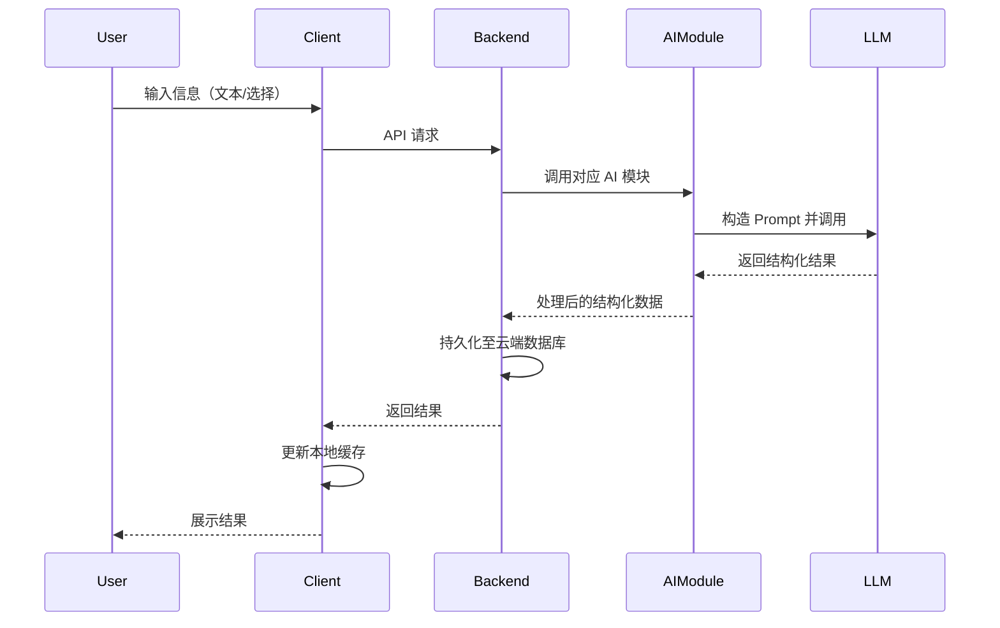

# 技术设计文档：Apex Advisor

## 概述

Apex Advisor 是一款职场适应辅助 App，帮助用户系统化地整理职场关键信息，并基于这些信息自动生成适合具体场景的 AI Prompt 模板。系统采用四层 Profile 架构，结合多个 AI 处理模块，实现从信息录入、智能提炼到 Prompt 生成的完整闭环。

### 核心设计目标

- 四层 Profile 架构（Team / Company / Work / Industry）提供结构化的职场信息管理
- 多个专用 AI 模块（Behavior_Profiler、Intelligence_Classifier、Industry_Classifier、Prompt_Engine、Deliverable_Review）各司其职
- 知识库持久化存储与跨设备实时同步
- 五大场景类别的智能 Prompt 生成

---

## UI 设计规范

> 设计主题：深海领航——以深邃的大海为灵感，用沉稳的深蓝色调搭配灵动的海洋元素，在专业感中注入活泼的生命力，让每一次交互都像乘风破浪般流畅自然。

---

### 1. 色彩系统

#### 主色调（深蓝/大海）

| 色彩角色 | 色值 | 用途 |
|---------|------|------|
| 深海蓝（Primary） | `#0A2342` | 导航栏背景、主要标题、强调文字 |
| 海洋蓝（Primary Light） | `#1A4A7A` | 主要按钮、激活状态、链接 |
| 浪花蓝（Primary Lighter） | `#2E7DC5` | 次级按钮、标签选中态、进度条 |
| 天际蓝（Accent） | `#4FACDE` | 高亮元素、图标激活色、渐变起点 |

#### 辅助色

| 色彩角色 | 色值 | 用途 |
|---------|------|------|
| 珊瑚橙（Secondary） | `#FF6B6B` | 重要操作按钮、Taboo 警示标签 |
| 海草绿（Success） | `#2ECC8A` | 成功状态、"符合"标注、同步完成 |
| 琥珀黄（Warning） | `#F5A623` | 警告提示、Contextual_Nudge、待更新标记 |
| 深红（Danger） | `#E53E3E` | 错误状态、删除操作、禁忌雷区高亮 |

#### 背景色

| 色彩角色 | 色值 | 用途 |
|---------|------|------|
| 深海背景（BG Primary） | `#060F1E` | 全局深色背景（深色模式） |
| 海面背景（BG Secondary） | `#0D1F3C` | 卡片背景、侧边栏 |
| 浅海背景（BG Surface） | `#132A4E` | 输入框背景、悬浮面板 |
| 浅色背景（BG Light） | `#F0F5FF` | 浅色模式主背景 |

#### 文字色

| 色彩角色 | 色值 | 用途 |
|---------|------|------|
| 主文字 | `#E8F4FD` | 深色模式主要文字 |
| 次要文字 | `#8BAFC8` | 辅助说明、时间戳、标签文字 |
| 占位文字 | `#4A6A85` | 输入框 placeholder |
| 深色主文字 | `#1A2B3C` | 浅色模式主要文字 |

#### 渐变色

```
海洋渐变（按钮/Banner）：linear-gradient(135deg, #1A4A7A 0%, #2E7DC5 50%, #4FACDE 100%)
深海渐变（背景装饰）：linear-gradient(180deg, #060F1E 0%, #0A2342 60%, #1A4A7A 100%)
极光渐变（特殊高亮）：linear-gradient(90deg, #4FACDE 0%, #2ECC8A 100%)
```

---

### 2. 图标使用规范

#### 核心功能模块图标语义

| 模块 | 主图标 | 辅助图标 | 语义说明 |
|------|--------|---------|---------|
| Layer 1 — Know Your Team | ⚓ 锚（Anchor） | 👤 人物轮廓（Person） | 锚象征稳固的人际关系与信任基础；人物图标用于成员条目 |
| Layer 2 — Know Your Company | 🧭 罗盘（Compass） | 🏛️ 建筑（Building） | 罗盘象征战略方向感；建筑代表组织与公司结构 |
| Layer 3 — Know Your Work | ⛵ 舵轮（Helm/Wheel） | 📄 文档（Document） | 舵轮象征掌控工作方向；文档图标用于交付物与纪要 |
| Layer 4 — Know Your Industry | 🔭 望远镜（Telescope） | 🌊 波浪（Wave） | 望远镜象征前瞻洞察；波浪代表行业动态的起伏变化 |
| Chatbox | 💬 对话气泡（Chat Bubble） | 🐬 海豚（Dolphin） | 气泡代表对话交互；海豚象征智慧与灵动的 AI 助手 |
| Prompt Engine | ✨ 星光（Sparkle） | 🗺️ 航海图（Map） | 星光代表 AI 生成魔法；航海图象征场景化导航 |
| 同步/云端 | ☁️ 云朵（Cloud） | 🔄 循环箭头（Sync） | 标准云同步语义，保持直觉性 |
| 警告/Taboo | ⚠️ 警示（Warning） | 🪸 珊瑚（Coral） | 珊瑚礁暗示"危险区域，请绕行" |
| 成功/完成 | ✅ 勾选（Check） | 🐚 贝壳（Shell） | 贝壳象征收获与完成 |
| 设置 | ⚙️ 齿轮（Gear） | 🔱 三叉戟（Trident） | 三叉戟作为高级设置或管理功能的装饰性图标 |

#### 图标风格规范

- **主导航图标**：线性风格（Outline），线宽 1.5px，尺寸 24×24px，激活时切换为填充（Filled）风格
- **功能操作图标**：线性风格，尺寸 20×20px，悬停时颜色从 `#8BAFC8` 过渡到 `#4FACDE`
- **状态指示图标**：填充风格，尺寸 16×16px，颜色跟随状态色（成功绿/警告黄/错误红）
- **装饰性海洋图标**：用于空状态页、引导页和 Banner，尺寸自由，可带透明度（30%–60%）作为背景装饰
- **图标库推荐**：优先使用 Phosphor Icons 或 Lucide Icons（线性风格一致，海洋相关图标丰富）

---

### 3. 交互动效规范

#### 页面切换动效

- **主页面切换**：水平滑动过渡，模拟海浪推进感，时长 300ms，缓动函数 `cubic-bezier(0.25, 0.46, 0.45, 0.94)`
- **Layer 层级切换**：垂直上浮进入，模拟从海底浮出水面，时长 250ms，配合轻微的透明度渐变（0→1）
- **模态框/抽屉**：从底部滑入，带轻微弹性（spring 动效），模拟浮力感

#### 数据加载动效

- **全局加载**：波浪形进度条，使用 SVG 路径动画，颜色为 `#2E7DC5` → `#4FACDE` 渐变，波浪周期 1.5s
- **卡片骨架屏**：使用流光扫描动效（shimmer），方向从左到右，颜色为深蓝色系渐变，模拟海面光影
- **列表加载更多**：底部出现气泡上浮动效，3 个气泡依次延迟 100ms 出现，颜色为 `#4FACDE`

#### AI 处理中状态

- **AI 思考中**：三个圆点以波浪形节奏跳动（非同步跳动，依次延迟 150ms），颜色为天际蓝 `#4FACDE`
- **Behavior_Profiler 对话中**：输入框旁显示海豚图标轻微摆动动效（左右摇摆 ±5°，周期 2s）
- **Intelligence_Classifier 处理中**：罗盘图标缓慢旋转（360°/3s，匀速），表示正在"定向分析"
- **Deliverable_Review 评审中**：舵轮图标旋转动效（360°/2s），配合进度百分比文字

#### 微交互动效

- **按钮点击**：轻微下压（scale 0.97）+ 涟漪扩散效果（ripple），涟漪颜色为白色 20% 透明度
- **卡片悬停**：上浮 4px（translateY -4px）+ 阴影加深，时长 200ms，模拟浮力
- **标签选中**：背景色从透明渐变到 `#1A4A7A`，同时图标从线性切换为填充，时长 150ms
- **Contextual_Nudge 出现**：从顶部滑入 + 透明度 0→1，时长 400ms，带轻微弹性
- **数据保存成功**：贝壳图标短暂出现并上浮消失，配合绿色勾选动效，时长 600ms

---

### 4. 组件视觉规范

#### 卡片（Card）

```
背景：rgba(13, 31, 60, 0.8)（半透明毛玻璃效果）
backdrop-filter: blur(12px)
边框：1px solid rgba(78, 172, 222, 0.2)（淡蓝色半透明边框）
圆角：16px（大圆角，柔和海洋感）
阴影：0 8px 32px rgba(0, 0, 0, 0.3), 0 0 0 1px rgba(78, 172, 222, 0.1)
悬停阴影：0 12px 40px rgba(46, 125, 197, 0.25)
```

#### 按钮（Button）

- **主要按钮（Primary）**：海洋渐变背景 `linear-gradient(135deg, #1A4A7A, #2E7DC5)`，圆角 12px，白色文字，悬停时渐变方向反转
- **次要按钮（Secondary）**：透明背景 + `1.5px solid #2E7DC5` 边框，圆角 12px，蓝色文字，悬停时填充浅蓝背景
- **危险按钮（Danger）**：珊瑚橙 `#FF6B6B` 背景，圆角 12px，白色文字
- **幽灵按钮（Ghost）**：完全透明，仅文字颜色 `#4FACDE`，悬停时出现淡蓝色下划线

#### 标签（Tag / Badge）

```
背景：rgba(46, 125, 197, 0.15)
边框：1px solid rgba(46, 125, 197, 0.4)
圆角：20px（胶囊形，模拟气泡）
文字：#4FACDE
内边距：4px 12px
```

- **Behavior_Tag**：带置信度颜色深浅变化，高置信度（>0.8）用 `#2E7DC5`，低置信度（<0.4）用 `#4A6A85`
- **Taboo 标签**：背景 `rgba(229, 62, 62, 0.15)`，边框 `rgba(229, 62, 62, 0.5)`，文字 `#E53E3E`，左侧带 ⚠️ 图标

#### 输入框（Input）

```
背景：rgba(19, 42, 78, 0.6)
边框：1px solid rgba(78, 172, 222, 0.3)
圆角：12px
聚焦边框：1.5px solid #4FACDE，同时出现 0 0 0 3px rgba(79, 172, 222, 0.15) 外发光
文字：#E8F4FD
Placeholder：#4A6A85
```

#### 进度条（Progress Bar）

```
轨道背景：rgba(78, 172, 222, 0.15)
填充色：linear-gradient(90deg, #2E7DC5, #4FACDE)
圆角：4px
高度：6px（细线型，精致感）
```

用于 Behavior_Tag 置信度可视化，填充色深浅随置信度变化。

#### 分割线

```
颜色：rgba(78, 172, 222, 0.15)
样式：1px solid
```

---

### 5. 主要页面布局建议

#### 5.1 Team 档案页（Layer 1 — Know Your Team）

```
┌─────────────────────────────────────────────┐
│  ⚓ Know Your Team          [+ 添加成员]     │  ← 顶部导航栏（深海蓝背景）
├──────────────┬──────────────────────────────┤
│              │  ┌──────────────────────────┐│
│  成员列表    │  │  👤 [成员头像/首字母]     ││  ← 成员档案卡片（毛玻璃效果）
│  （左侧栏）  │  │  姓名 · 角色             ││
│              │  ├──────────────────────────┤│
│  [成员卡片]  │  │  💬 沟通偏好  🎯 决策风格 ││  ← 标签区（胶囊标签）
│  [成员卡片]  │  │  📊 汇报偏好             ││
│  [成员卡片]  │  ├──────────────────────────┤│
│              │  │  🧠 行为特征标签          ││  ← Behavior_Tag 列表（带进度条）
│              │  │  [标签] ████░░ 0.7       ││
│              │  │  [标签] ██████ 0.9       ││
│              │  ├──────────────────────────┤│
│              │  │  ⚠️ 禁忌雷区（红色高亮）  ││  ← Taboo 区（警示色背景）
│              │  ├──────────────────────────┤│
│              │  │  [🐬 开始 AI 建档对话]   ││  ← 主要 CTA 按钮（渐变色）
│              │  └──────────────────────────┘│
└──────────────┴──────────────────────────────┘
```

- 左侧成员列表使用卡片列表，选中成员时右侧滑入详情（水平滑动动效）
- 行为特征区使用进度条可视化置信度，颜色深浅随置信度变化
- Taboo 区域使用红色半透明背景 + 警示图标，视觉上形成"危险区域"感知

#### 5.2 Company 情报页（Layer 2 — Know Your Company）

```
┌─────────────────────────────────────────────┐
│  🧭 Know Your Company       [+ 投喂情报]    │
├─────────────────────────────────────────────┤
│  ┌─────────────────────────────────────────┐│
│  │  🌊 实时洞察（24h 高亮区）              ││  ← 顶部实时洞察 Banner（极光渐变背景）
│  │  · [新增] 战略方向：...                 ││
│  └─────────────────────────────────────────┘│
├──────────┬──────────┬──────────┬────────────┤
│📈 经营   │🎯 战略   │🏛️ 文化   │📋 内部规则 │  ← 四维度 Tab（横向切换）
│业绩动态  │方向重点  │信号      │与潜规则    │
├──────────┴──────────┴──────────┴────────────┤
│  [洞察卡片]  更新于 2天前 · 来源：会议记录  │  ← 洞察卡片（毛玻璃效果）
│  [洞察卡片]  更新于 5天前 · 来源：内部通知  │
├─────────────────────────────────────────────┤
│  👥 关键干系人                [+ 添加]      │  ← 干系人列表（折叠区域）
└─────────────────────────────────────────────┘
```

- 四个维度使用横向 Tab 切换，Tab 激活时带下划线波浪动效
- 实时洞察区使用极光渐变背景，24h 后自动淡出归入常规分区

#### 5.3 Work 工作页（Layer 3 — Know Your Work）

```
┌─────────────────────────────────────────────┐
│  ⛵ Know Your Work                          │
├──────────────────────────────────────────────┤
│  [交付物标准] [会议纪要] [工作线] [Follow-up]│  ← 二级 Tab 导航
├──────────────────────────────────────────────┤
│  交付物标准库                                │
│  ┌──────────────────────────────────────────┐│
│  │  📄 向上汇报 PPT                         ││  ← 标准条目卡片
│  │  5个维度已填写  ·  历史评审 3次           ││
│  │  [📊 查看规律洞察]  [✏️ 评审草稿]        ││
│  └──────────────────────────────────────────┘│
│  ┌──────────────────────────────────────────┐│
│  │  📄 战略分析报告                         ││
│  │  3个维度已填写  ·  历史评审 1次           ││
│  └──────────────────────────────────────────┘│
└──────────────────────────────────────────────┘
```

- 评审报告页面使用五列卡片展示五个维度，符合项显示绿色贝壳图标，不符合项显示红色珊瑚图标
- Deliverable_Pattern 规律洞察以独立卡片展示，背景使用极光渐变，突出 AI 洞察感

#### 5.4 Industry 情报页（Layer 4 — Know Your Industry）

```
┌─────────────────────────────────────────────┐
│  🔭 Know Your Industry      [+ 投喂材料]    │
├─────────────────────────────────────────────┤
│  [行业趋势] [竞争格局] [监管动态] [数据要点] │  ← 四维度 Tab
├─────────────────────────────────────────────┤
│  数据要点（结构化卡片展示）                  │
│  ┌──────────┐ ┌──────────┐ ┌──────────┐    │
│  │ 42.3%    │ │ ¥1.2T    │ │ +18%     │    │  ← 数据卡片（数值突出展示）
│  │ 市场增速 │ │ 市场规模 │ │ YoY增长  │    │
│  │ 来源·日期│ │ 来源·日期│ │ 来源·日期│    │
│  └──────────┘ └──────────┘ └──────────┘    │
├─────────────────────────────────────────────┤
│  💬 话题素材库                              │
│  [标签筛选：行业趋势] [竞争格局] [监管]     │
│  ┌──────────────────────────────────────────┐│
│  │  🌊 话题：AI 重塑行业格局               ││  ← 话题素材卡片
│  │  核心观点：...  数据支撑：...            ││
│  └──────────────────────────────────────────┘│
└─────────────────────────────────────────────┘
```

- 数据要点维度使用大字号数值卡片，突出数据感，背景带轻微波浪纹装饰
- 话题素材卡片支持标签筛选，筛选标签使用胶囊气泡样式

#### 5.5 Chatbox 双 Box 布局

```
┌─────────────────────────────────────────────────────────────┐
│  💬 Apex Advisor Chat                    [Context: ⚓🧭⛵🔭] │  ← 顶部栏（Context_Tag 选择）
├──────────────────────────────────┬──────────────────────────┤
│                                  │                          │
│  主 Box（AI 回答）               │  侧 Box（思维链）        │
│                                  │  [默认折叠，点击展开]    │
│  🐬 AI 回答内容...               │                          │
│                                  │  🧠 思考过程：           │
│  ─────────────────────────────   │  1. 调取 Team Profile... │
│  📎 信息来源：                   │  2. 分析行为标签...      │
│  · ⚓ Team > 行为标签 > 回避冲突 │  3. 结合 Taboo 约束...   │
│  · 🧭 Company > 战略方向         │                          │
│                                  │                          │
├──────────────────────────────────┴──────────────────────────┤
│  [/ 快捷指令]  输入你的问题...                    [发送 →]  │  ← 输入栏（毛玻璃背景）
└─────────────────────────────────────────────────────────────┘
```

- 主 Box 占 60% 宽度，侧 Box 占 40%，侧 Box 默认折叠为细条（点击展开）
- 信息来源标注使用对应 Layer 的图标（⚓🧭⛵🔭）+ 字段路径，颜色使用天际蓝
- 输入框使用毛玻璃效果，`/` 触发快捷指令面板时从底部弹出，带波浪形顶部边缘装饰
- AI 思考中状态：主 Box 显示海豚图标 + 波浪跳动动效，侧 Box 显示罗盘旋转动效

---

## 架构

### 整体架构图

```mermaid
graph TB
    subgraph Client["客户端（iOS / Android / Web）"]
        UI[用户界面层]
        LocalDB[(本地缓存 SQLite)]
        SyncManager[同步管理器]
    end

    subgraph Backend["后端服务"]
        AuthService[认证服务]
        ProfileService[Profile 管理服务]
        AIOrchestrator[AI 编排层]
        CloudDB[(云端数据库 PostgreSQL)]
        SyncService[同步服务]
    end

    subgraph AIModules["AI 处理模块"]
        BehaviorProfiler[Behavior_Profiler]
        IntelligenceClassifier[Intelligence_Classifier]
        IndustryClassifier[Industry_Classifier]
        PromptEngine[Prompt_Engine]
        DeliverableReview[Deliverable_Review]
        FollowUpExtractor[FollowUp_Extractor]
    end["大语言模型服务"]
        LLMProvider[LLM API（OpenAI / Claude 等）]
    end

    UI --> LocalDB
    UI --> SyncManager
    SyncManager --> SyncService
    SyncService --> CloudDB
    UI --> AuthService
    UI --> ProfileService
    ProfileService --> CloudDB
    ProfileService --> AIOrchestrator
    AIOrchestrator --> BehaviorProfiler
    AIOrchestrator --> IntelligenceClassifier
    AIOrchestrator --> IndustryClassifier
    AIOrchestrator --> PromptEngine
    AIOrchestrator --> DeliverableReview
    AIOrchestrator --> FollowUpExtractor
    BehaviorProfiler --> LLMProvider
    IntelligenceClassifier --> LLMProvider
    IndustryClassifier --> LLMProvider
    PromptEngine --> LLMProvider
    DeliverableReview --> LLMProvider
    FollowUpExtractor --> LLMProvider
```

### 分层架构说明

系统采用三层架构：

1. **客户端层**：负责用户交互、本地数据缓存和离线支持
2. **后端服务层**：负责业务逻辑、数据持久化和 AI 模块编排
3. **AI 处理层**：各专用 AI 模块通过 LLM API 实现智能处理

### 数据流



---

## 组件与接口

### 1. 认证服务（AuthService）

负责用户注册、登录和会话管理。

```
POST /auth/register     — 用户注册，创建空白四层 Profile
POST /auth/login        — 用户登录，返回 JWT Token
POST /auth/logout       — 用户登出
POST /auth/refresh      — 刷新 Token
```

**设计决策**：使用 JWT + Refresh Token 机制，Access Token 有效期 1 小时，Refresh Token 有效期 30 天，支持多设备并发登录。

### 2. Profile 管理服务（ProfileService）

统一管理四层 Profile 的 CRUD 操作。

```
GET    /profiles/{userId}                          — 获取用户全量 Profile（登录后 500ms 内响应）
PUT    /profiles/{userId}/team/members             — 更新团队成员列表
PUT    /profiles/{userId}/company/intelligence     — 更新公司情报知识库
PUT    /profiles/{userId}/work/standards           — 更新交付物标准库
PUT    /profiles/{userId}/work/meeting-notes       — 创建/更新会议纪要
PUT    /profiles/{userId}/work/workstreams         — 创建/更新 Workstream
PUT    /profiles/{userId}/work/follow-up-items     — 创建/更新 FollowUp_Item
PUT    /profiles/{userId}/industry/intelligence    — 更新行业情报知识库
```

### 3. Behavior_Profiler 模块

负责通过多轮对话提炼团队成员的行为特征标签。

**接口**：
```
POST /ai/behavior-profiler/start
  Input:  { memberId, existingTags: BehaviorTag[] }
  Output: { sessionId, greeting: string }

POST /ai/behavior-profiler/chat
  Input:  { sessionId, userMessage: string }
  Output: { reply: string, suggestedTags?: BehaviorTag[] }

POST /ai/behavior-profiler/finalize
  Input:  { sessionId }
  Output: { tags: BehaviorTag[], updateMode: "increment" | "overwrite" }
```

**处理逻辑**：
- 启动时读取成员已有标签作为上下文
- 多轮对话中持续积累行为描述
- 对话结束时提炼标签，提供增量更新或覆盖选择
- 标签格式：`{ id, label, category, confidence }`

### 4. Intelligence_Classifier 模块

负责对公司相关原始信息进行分类提炼，更新 Company_Intelligence 知识库。

**接口**：
```
POST /ai/intelligence-classifier/analyze
  Input:  { inputs: IntelligenceInput[], existingIntelligence: CompanyIntelligence }
  Output: { digest: IntelligenceDigest, updateMode: "increment" | "overwrite" }
```

**四维分类**：经营业绩动态 / 战略方向与重点 / 组织文化信号 / 内部规则与潜规则

**最小输入长度校验**：输入内容少于 50 字时返回提示，建议补充更多背景信息。

### 5. Industry_Classifier 模块

负责对行业原始材料进行分类提炼，更新 Industry_Intelligence 知识库，并生成 Topic_Material。

**接口**：
```
POST /ai/industry-classifier/analyze
  Input:  { inputs: IndustryInput[], existingIntelligence: IndustryIntelligence }
  Output: { digest: IndustryDigest, topicMaterials: TopicMaterial[], conflictFlags: ConflictFlag[] }
```

**四维分类**：行业趋势 / 竞争格局 / 监管动态 / 数据要点

**冲突检测**：与已有洞察对比，在 Digest 中标注"新增"、"补充"或"与已有洞察存在冲突"。

### 6. Prompt_Engine 模块

根据用户选择的 Scene 和四层 Profile 数据生成 Prompt_Template。

**接口**：
```
POST /ai/prompt-engine/generate
  Input:  {
    scene: SceneType,
    teamProfile: TeamProfile,
    companyProfile: CompanyProfile,
    workProfile: WorkProfile,
    industryProfile: IndustryProfile,
    targetMemberId?: string
  }
  Output: { template: string, placeholders: Placeholder[], missingProfiles: string[] }
```

**五大 Scene 类型及注入逻辑**：

| Scene | 主要注入来源 |
|-------|------------|
| 沟通与汇报 | Team_Profile（行为标签、Taboo）+ Work_Profile（交付物标准） |
| 会议与展示准备 | Team_Profile（沟通偏好）+ Company_Profile（战略方向） |
| 材料组织与提案撰写 | Work_Profile（思路框架、立场）+ Company_Profile（文化信号） |
| 研究与调研实施 | Industry_Profile（行业趋势、数据要点）+ Company_Profile |
| 项目进度规划与管理 | Work_Profile（项目列表）+ Team_Profile（决策风格） |

**占位符机制**：当对应 Profile 为空时，生成包含 `{{PLACEHOLDER_XXX}}` 格式占位符的模板，并附带补充提示。

**Taboo 注入**：自动将目标成员的 Taboo 字段注入 Prompt 约束条件区块。

### 7. Deliverable_Review 模块

根据 Deliverable_Standard 对草稿进行逐项评审。

**接口**：
```
POST /ai/deliverable-review/review
  Input:  { standard: DeliverableStandard, draft: string, reviewHistory?: ReviewHistory[] }
  Output: { report: ReviewReport }  // 5 秒内响应

POST /ai/deliverable-review/save-history
  Input:  { userId: string, standardId: string, report: ReviewReport }
  Output: { history: ReviewHistory }  // 将本次评审结果持久化为 Review_History 记录

GET  /ai/deliverable-review/history/{standardId}
  Input:  { userId: string }
  Output: { histories: ReviewHistory[] }  // 按时间倒序返回该 Work_Scene 下的所有历史评审记录

POST /ai/deliverable-review/analyze-pattern
  Input:  { standardId: string, userId: string, histories: ReviewHistory[] }
  Output: { pattern: DeliverablePattern }  // 基于历史记录提炼规律洞察（histories.length >= 3 时触发）
```

**评审报告结构**：按五个 Standard_Dimension 分区，每项标注"符合"/"不符合"，不符合项提供具体说明和改进建议。

**历史记录与规律提炼逻辑**：
- 每次评审完成后自动调用 `save-history` 持久化评审结果
- 当某 Deliverable_Standard 下的历史记录数量达到 3 条时，自动触发 `analyze-pattern`
- 后续每次新增评审记录后重新触发规律提炼，更新 Deliverable_Pattern
- 下次评审时，将已有 Deliverable_Pattern 对应的 ReviewHistory 作为上下文传入 `review` 接口，使 AI 给出更有针对性的建议

### 8. FollowUp_Extractor 模块

负责从 Meeting_Note 中自动识别 Action Items，生成结构化的 FollowUp_Item 列表。

**接口**：
```
POST /ai/follow-up-extractor/extract
  Input:  {
    meetingNoteId: string,
    content: string,
    workstreams: Workstream[]   // 当前用户的 Workstream 列表，用于自动关联
  }
  Output: { items: FollowUpItem[] }  // 5 秒内响应

POST /ai/follow-up-extractor/save
  Input:  { userId: string, meetingNoteId: string, items: FollowUpItem[] }
  Output: { saved: FollowUpItem[] }
```

**处理逻辑**：
- 分析会议纪要全文，识别含有明确行动指向的句子（如"需要 X 在 Y 日期前完成 Z"）
- 尝试从文本中提取负责人姓名和截止日期，填入对应字段
- 与用户现有 Workstream 列表进行语义匹配，自动填入 workstreamId（置信度低时留空）
- 生成的 FollowUp_Item 列表供用户确认后再持久化，不自动保存

### 9. 同步服务（SyncService）

负责本地数据与云端数据的双向同步。

**同步策略**：
- 在线状态：每次保存操作实时同步至云端（1 秒内完成）
- 离线状态：写入本地 SQLite，标记为 `pending_sync`
- 网络恢复：自动触发增量同步，上传所有 `pending_sync` 记录
- 冲突处理：基于时间戳检测冲突，向用户展示冲突详情并提供选择

**跨设备同步**：设备 B 打开 App 时，拉取云端最新数据，5 秒内完成同步。

---

## 数据模型

### 用户账户

```typescript
interface User {
  id: string;           // UUID
  email: string;
  passwordHash: string;
  createdAt: Date;
  lastLoginAt: Date;
}
```

### Team Profile

```typescript
interface TeamMember {
  id: string;
  userId: string;
  name: string;                    // 必填
  role: string;                    // 必填
  personalityTraits: string;       // 性格特征（自由文本）
  communicationPreference: string; // 沟通偏好
  decisionStyle: string;           // 决策风格
  reportingPreference: "data" | "emotional" | "concise";
  taboo: string;                   // 禁忌雷区
  behaviorTags: BehaviorTag[];     // 行为特征标签列表
  notes: string;                   // 自由文本备注
  createdAt: Date;
  updatedAt: Date;
}

interface BehaviorTag {
  id: string;
  label: string;       // 如：回避冲突型、数据驱动型
  category: string;    // 标签分类
  confidence: number;  // AI 置信度 0-1
  source: "ai" | "manual";
}
```

### Company Profile

```typescript
interface CompanyProfile {
  userId: string;
  intelligence: CompanyIntelligence;
  stakeholders: StakeholderNote[];
  updatedAt: Date;
}

interface CompanyIntelligence {
  businessPerformance: IntelligenceItem[];  // 经营业绩动态
  strategicDirection: IntelligenceItem[];   // 战略方向与重点
  culturalSignals: IntelligenceItem[];      // 组织文化信号
  internalRules: IntelligenceItem[];        // 内部规则与潜规则
}

interface IntelligenceItem {
  id: string;
  content: string;
  sourceType: "meeting" | "notice" | "speech" | "financial" | "news" | "other";
  lastUpdatedAt: Date;
}

interface IntelligenceInput {
  id: string;
  userId: string;
  content: string;
  sourceType: "meeting" | "notice" | "speech" | "financial" | "news" | "other";
  createdAt: Date;
}

interface IntelligenceDigest {
  businessPerformance: string;
  strategicDirection: string;
  culturalSignals: string;
  internalRules: string;
  generatedAt: Date;
}

interface StakeholderNote {
  id: string;
  name: string;
  department: string;
  influenceDescription: string;
}
```

### Work Profile

```typescript
interface WorkProfile {
  userId: string;
  deliverableStandards: DeliverableStandard[];
  projects: Project[];
  meetingNotes: MeetingNote[];
  workstreams: Workstream[];
  followUpItems: FollowUpItem[];
  updatedAt: Date;
}

interface DeliverableStandard {
  id: string;
  workScene: string;              // 必填，如：向上汇报 PPT
  formatRequirements: string;     // 格式要求
  styleRequirements: string;      // 体例要求
  thinkingFramework: string;      // 思路框架
  perspectiveAndStance: string;   // 立场与视角
  habitPreferences: string;       // 习惯偏好
  createdAt: Date;
  updatedAt: Date;
}

interface ReviewReport {
  standardId: string;
  dimensions: DimensionReview[];
  generatedAt: Date;
}

interface DimensionReview {
  dimension: "format" | "style" | "framework" | "perspective" | "habit";
  status: "compliant" | "non-compliant";
  details: string;
  suggestions?: string;
}

interface ReviewHistory {
  id: string;
  standardId: string;
  userId: string;
  reviewedAt: Date;
  dimensions: DimensionReview[];  // 本次各维度评审结果
  overallCompliance: number;       // 本次合规率 0-1（符合维度数 / 总维度数）
}

interface DeliverablePattern {
  standardId: string;
  userId: string;
  basedOnCount: number;            // 基于多少条 Review_History 生成
  persistentIssues: string[];      // 反复不符合的维度及描述
  improvingDimensions: string[];   // 持续改善的维度及描述
  complianceTrend: "improving" | "declining" | "stable";  // 整体合规率趋势
  trendDescription: string;        // 趋势的文字说明
  generatedAt: Date;
  updatedAt: Date;
}

interface Project {
  id: string;
  name: string;
  status: "in-progress" | "completed" | "paused";
  deadline?: Date;
  description?: string;
}

interface MeetingNote {
  id: string;
  userId: string;
  title: string;
  meetingDate: Date;
  participants?: string;   // 参会人员（可选，自由文本）
  content: string;         // 会议纪要正文
  createdAt: Date;
  updatedAt: Date;
}

interface Workstream {
  id: string;
  userId: string;
  name: string;            // 必填
  progressDescription: string;  // 当前进度描述
  goalsAndRequirements: string; // 目标与要求
  owner?: string;          // 负责人（可选）
  status: "in-progress" | "completed" | "paused";
  createdAt: Date;
  updatedAt: Date;
}

interface FollowUpItem {
  id: string;
  userId: string;
  meetingNoteId?: string;  // 来源会议纪要 ID（手动创建时可为空）
  description: string;     // 事项描述
  owner?: string;          // 负责人（可选）
  dueDate?: Date;          // 截止日期（可选）
  workstreamId?: string;   // 关联 Workstream ID（可选）
  status: "pending" | "completed";
  createdAt: Date;
  updatedAt: Date;
}
```

### Industry Profile

```typescript
interface IndustryProfile {
  userId: string;
  intelligence: IndustryIntelligence;
  topicMaterials: TopicMaterial[];
  updatedAt: Date;
}

interface IndustryIntelligence {
  industryTrends: IndustryItem[];    // 行业趋势
  competitiveLandscape: IndustryItem[]; // 竞争格局
  regulatoryDynamics: IndustryItem[]; // 监管动态
  dataHighlights: IndustryItem[];    // 数据要点
}

interface IndustryItem {
  id: string;
  content: string;
  sourceType: "research" | "data" | "dynamics" | "competitor" | "regulatory" | "other";
  conflictFlag?: "new" | "supplement" | "conflict";
  lastUpdatedAt: Date;
}

interface IndustryInput {
  id: string;
  userId: string;
  content: string;
  sourceType: "research" | "data" | "dynamics" | "competitor" | "regulatory" | "other";
  createdAt: Date;
}

interface IndustryDigest {
  industryTrends: string;
  competitiveLandscape: string;
  regulatoryDynamics: string;
  dataHighlights: string;
  conflictFlags: ConflictFlag[];
  generatedAt: Date;
}

interface ConflictFlag {
  itemId: string;
  type: "new" | "supplement" | "conflict";
  description: string;
}

interface TopicMaterial {
  id: string;
  title: string;
  coreInsight: string;
  dataSupport: string;
  createdAt: Date;
  updatedAt: Date;
}
```

### Prompt Template

```typescript
type SceneType =
  | "communication_reporting"
  | "meeting_presentation"
  | "material_proposal"
  | "research_investigation"
  | "project_planning";

interface PromptTemplate {
  id: string;
  userId: string;
  scene: SceneType;
  content: string;
  placeholders: Placeholder[];
  isCustomized: boolean;
  needsRefresh: boolean;    // Profile 更新后标记为 true
  createdAt: Date;
  updatedAt: Date;
}

interface Placeholder {
  key: string;              // 如：PLACEHOLDER_TEAM_TABOO
  description: string;      // 提示用户补充的说明
  profileLayer: "team" | "company" | "work" | "industry";
}
```

### 同步状态

```typescript
interface SyncRecord {
  id: string;
  userId: string;
  entityType: string;
  entityId: string;
  localVersion: number;
  cloudVersion: number;
  status: "synced" | "pending_sync" | "conflict";
  lastSyncedAt?: Date;
}

interface ConflictDetail {
  entityType: string;
  entityId: string;
  localData: unknown;
  cloudData: unknown;
  localUpdatedAt: Date;
  cloudUpdatedAt: Date;
}
```


---

## 正确性属性

*属性（Property）是在系统所有有效执行中都应成立的特征或行为——本质上是对系统应该做什么的形式化陈述。属性是人类可读规范与机器可验证正确性保证之间的桥梁。*

### 属性 1：数据隔离

*对于任意*两个不同的用户 A 和 B，用户 A 的所有 Profile 数据（Team/Company/Work/Industry）对用户 B 均不可见，用户 B 的查询结果中不应包含任何属于用户 A 的数据。

**验证需求：1.1**

---

### 属性 2：注册后空 Profile 初始化

*对于任意*新注册的用户，注册完成后系统应自动创建包含四层结构（Team_Profile、Company_Profile、Work_Profile、Industry_Profile）的空白 Profile 集合，每层均存在且初始为空。

**验证需求：1.2**

---

### 属性 3：无效凭据拒绝

*对于任意*无效的登录凭据（错误密码、不存在的邮箱、格式错误的输入），系统应拒绝登录请求并返回明确的错误提示，不应返回任何用户数据。

**验证需求：1.3**

---

### 属性 4：Profile 数据 CRUD Round Trip

*对于任意*用户和任意 Profile 层（Team/Company/Work/Industry）中的任意数据条目，执行创建后读取应得到相同内容，执行更新后读取应得到更新后的内容，执行删除后读取应返回不存在，且所有操作结果应持久化至云端存储。

**验证需求：2.1, 2.3, 2.9, 3.7, 3.8, 4.1, 4.8, 5.8, 5.9, 8.1**

---

### 属性 5：必填字段验证

*对于任意*缺少必填字段（团队成员的姓名/角色，或 Deliverable_Standard 的 Work_Scene 名称）的保存请求，系统应拒绝保存并返回明确的必填字段提示，数据库中不应新增任何不完整的条目。

**验证需求：2.5, 4.4**

---

### 属性 6：行为标签生成格式

*对于任意*包含团队成员行为描述的对话输入，Behavior_Profiler 生成的行为特征标签列表应非空，且每个标签应包含 label、category、confidence 和 source 字段，confidence 值应在 0 到 1 之间。

**验证需求：2.7**

---

### 属性 7：行为标签注入 Prompt

*对于任意*拥有非空行为特征标签列表的团队成员，当 Prompt_Engine 生成涉及该成员的 Prompt_Template 时，生成的模板内容应包含该成员的行为特征标签信息，以支持行为预判推断。

**验证需求：2.11, 2.12**

---

### 属性 8：情报分类提炼四维结构

*对于任意*有效的 Intelligence_Input（公司情报）或 Industry_Input（行业情报），对应的 Classifier 生成的 Digest 应包含四个维度的内容字段（公司：经营业绩动态、战略方向与重点、组织文化信号、内部规则与潜规则；行业：行业趋势、竞争格局、监管动态、数据要点），且每个维度字段均存在（可为空字符串，但字段本身不可缺失）。

**验证需求：3.2, 5.2**

---

### 属性 9：情报增量合并

*对于任意*已有 Company_Intelligence 或 Industry_Intelligence 知识库，当用户确认新的 Digest 后，知识库中应包含原有内容加上新增内容，原有内容不应被意外删除（增量模式下），且合并后的条目总数应大于等于合并前的条目总数。

**验证需求：3.4, 3.6, 5.4**

---

### 属性 10：行业冲突检测标注

*对于任意*与已有 Industry_Intelligence 知识库中存在矛盾或补充关系的 Industry_Input，Industry_Classifier 生成的 Digest 中应包含对应的冲突标注（"新增"、"补充"或"与已有洞察存在冲突"），不应静默覆盖已有洞察。

**验证需求：5.6**

---

### 属性 11：话题素材生成

*对于任意*有效的 Industry_Input，Industry_Classifier 在提炼洞察的同时应生成至少一条 Topic_Material，每条 Topic_Material 应包含话题标题、核心观点和数据支撑三个字段，且字段均非空。

**验证需求：5.7**

---

### 属性 12：评审报告五维结构

*对于任意* Deliverable_Standard 和对应的 Draft_Input，Deliverable_Review 生成的评审报告应包含五个 Standard_Dimension 的评审结果（格式要求、体例要求、思路框架、立场与视角、习惯偏好），每个维度应标注"符合"或"不符合"，不符合项应包含具体说明字段。

**验证需求：4.5, 4.6**

---

### 属性 13：Prompt 生成包含 Profile 内容

*对于任意*拥有非空 Profile 数据的用户，当 Prompt_Engine 为特定 Scene 生成 Prompt_Template 时，生成的模板内容应包含与该 Scene 相关的 Profile 信息（Team 行为标签、Company 情报、Work 标准、Industry 洞察），且不应包含未填充的占位符（当对应 Profile 非空时）。

**验证需求：3.10, 4.9, 5.11, 6.1**

---

### 属性 14：自定义模板保存 Round Trip

*对于任意*用户编辑后的 Prompt_Template，将其保存为自定义模板后，通过模板 ID 读取应得到与保存时完全相同的内容，且该模板应在用户的模板列表中可见。

**验证需求：6.5**

---

### 属性 15：Profile 更新触发模板刷新标记

*对于任意*用户，当其任意层的 Profile 数据发生更新时，所有与该 Profile 层相关的已保存 Prompt_Template 的 needsRefresh 字段应被标记为 true，且在 Profile 更新前 needsRefresh 为 false 的模板在更新后应变为 true。

**验证需求：6.7**

---

### 属性 16：Taboo 注入 Prompt

*对于任意*拥有非空 Taboo 字段的团队成员，当 Prompt_Engine 生成涉及该成员的 Prompt_Template 时，生成的模板约束条件区块中应包含该成员的 Taboo 信息；当 Taboo 字段为空时，模板中应包含建议补充禁忌雷区信息的提示。

**验证需求：7.1, 7.2**

---

### 属性 17：离线编辑与同步

*对于任意*在网络不可用状态下进行的 Profile 编辑操作，数据应写入本地存储并标记为 pending_sync；当网络恢复后，所有 pending_sync 记录应自动同步至云端，同步完成后本地状态应更新为 synced。

**验证需求：8.3**

---

### 属性 18：冲突检测与展示

*对于任意*本地数据与云端数据存在时间戳冲突的场景，系统应向用户展示包含本地版本和云端版本详情的冲突信息，并提供"保留本地版本"或"使用云端版本"的选择，不应自动静默覆盖任何一方的数据。

**验证需求：8.4**

---

### 属性 19：评审历史积累与规律提炼

*对于任意*用户在特定 Work_Scene 下积累了 3 条及以上 Review_History 记录的情况，系统应能基于这些历史记录生成 Deliverable_Pattern；且对于任意两次规律提炼，若第二次比第一次多了至少一条新的评审记录，则第二次生成的 Deliverable_Pattern 的 basedOnCount 应严格大于第一次，确保规律洞察随历史积累单调递增地更新。

**验证需求：4.12, 4.13, 4.14**

---

### 属性 20：Follow-up 提取完整性

*对于任意*包含明确 Action Item 的 Meeting_Note，FollowUp_Extractor 提取生成的 FollowUp_Item 列表应满足以下条件：列表非空；每条 FollowUp_Item 均包含非空的 description 字段；若 workstreamId 字段非空，则该 ID 必须对应用户现有 Workstream 列表中的一条有效记录（引用完整性）；用户确认后持久化保存，随后通过读取接口查询应能得到与确认时完全一致的条目集合。

**验证需求：4.19, 4.20, 4.21**

---

## 错误处理

### AI 模块错误处理

| 错误场景 | 处理策略 |
|---------|---------|
| LLM API 调用超时 | 重试 3 次（指数退避），超时后返回友好错误提示，不丢失用户输入 |
| LLM 返回格式异常 | 解析失败时返回原始文本，提示用户手动整理，记录错误日志 |
| 输入内容过短（< 50 字） | 直接返回提示，不调用 LLM，节省 API 成本 |
| AI 生成内容为空 | 提示用户重试或补充更多背景信息 |

### 数据同步错误处理

| 错误场景 | 处理策略 |
|---------|---------|
| 网络不可用 | 写入本地缓存，标记 pending_sync，UI 显示离线状态指示 |
| 同步冲突 | 展示冲突详情，等待用户手动选择，不自动覆盖 |
| 云端写入失败 | 保留本地数据，后台重试，超过重试次数后通知用户 |
| 数据版本不一致 | 基于时间戳比较，触发冲突处理流程 |

### 用户输入验证错误处理

| 错误场景 | 处理策略 |
|---------|---------|
| 必填字段为空 | 阻止提交，高亮必填字段，显示明确提示 |
| 登录凭据无效 | 返回通用错误提示（不区分邮箱不存在还是密码错误，防止枚举攻击） |
| 草稿内容为空 | 阻止提交评审，提示用户输入草稿内容 |

---

## 测试策略

### 双轨测试方法

本系统采用单元测试与属性测试相结合的双轨测试方法，两者互补，共同保证系统正确性。

- **单元测试**：验证具体示例、边界条件和错误场景
- **属性测试**：通过随机生成大量输入验证普遍性属性

### 单元测试重点

单元测试聚焦于以下场景，避免过度编写（属性测试已覆盖大量输入组合）：

- 具体的 API 响应格式验证
- 各 AI 模块的 Prompt 构造逻辑
- 同步冲突解决的具体流程
- 边界条件：空 Profile 时的占位符生成、Taboo 为空时的提示生成
- 集成点：AI 模块与 ProfileService 之间的数据传递

### 属性测试配置

**选用库**：
- TypeScript/Node.js 后端：`fast-check`
- iOS 客户端：`SwiftCheck`
- Android 客户端：`kotest`（Property Testing 模块）

**配置要求**：
- 每个属性测试最少运行 **100 次迭代**
- 每个属性测试必须通过注释引用设计文档中的对应属性编号
- 标签格式：`// Feature: apex-advisor, Property {编号}: {属性描述}`

**属性测试实现要求**：

每条正确性属性对应一个属性测试，不得拆分为多个测试：

```typescript
// Feature: apex-advisor, Property 1: 数据隔离
test("用户数据隔离", () => {
  fc.assert(
    fc.property(
      fc.record({ userId: fc.uuid(), profileData: arbitraryProfile() }),
      fc.record({ userId: fc.uuid(), profileData: arbitraryProfile() }),
      (userA, userB) => {
        fc.pre(userA.userId !== userB.userId);
        // 验证 userA 的数据对 userB 不可见
        const resultForB = queryProfile(userB.userId);
        return !containsDataFrom(resultForB, userA.userId);
      }
    ),
    { numRuns: 100 }
  );
});
```

### 测试覆盖目标

| 测试类型 | 覆盖目标 |
|---------|---------|
| 属性测试 | 20 个正确性属性，每个 ≥ 100 次迭代 |
| 单元测试 | AI 模块 Prompt 构造、边界条件、错误处理 |
| 集成测试 | 端到端 Profile 保存与同步流程 |
| 性能测试 | 登录加载 500ms、保存 1s、Prompt 生成 3s、评审 5s |
